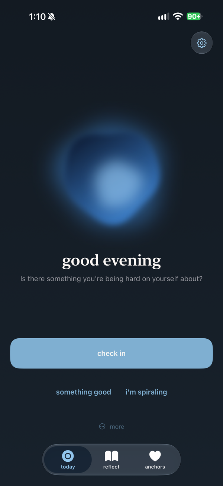
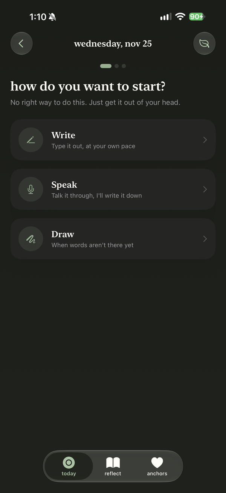
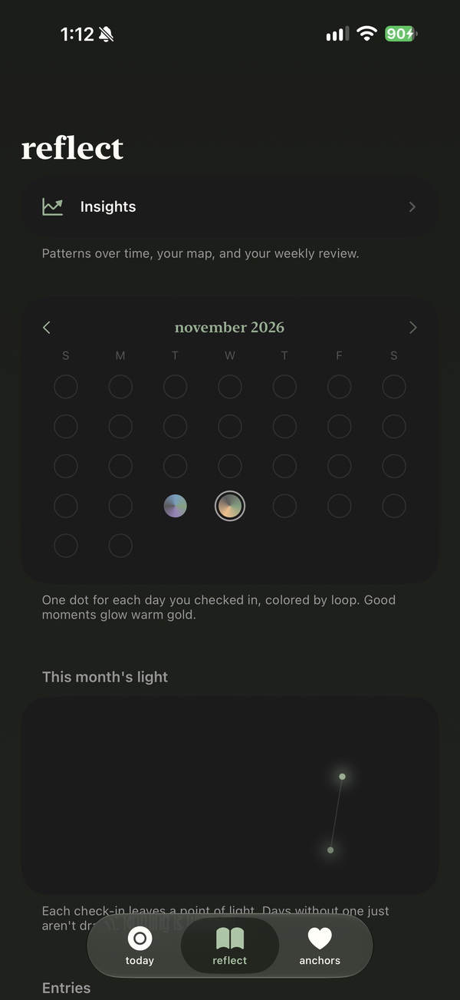

# Unconditional

A private iOS journal for working through self-doubt one day at a time. Write, speak, or draw, reframe the thought, and come back to what holds you. Built with SwiftUI, SwiftData, PencilKit, Swift Charts, and the Speech framework.

Everything stays on the phone. See [PRIVACY.md](PRIVACY.md).

## Screenshots
<!-- Add images to docs/screenshots/ and they show up here. -->
| Today | Check in | Reframe | Reflect | Anchors |
|---|---|---|---|---|
|  |  |  |  |  |

## Screens
- **Welcome tour**: on first launch, an animated orb and one idea per screen. One step asks which thoughts you tend to get stuck on: pick from general starters (not good enough, comparing myself, worrying about the future, people-pleasing, overthinking decisions, wasted effort, love and belonging) or name your own. Replay it from Settings.
- **The orb**: the heart of the app. It reflects what the app is doing, never what it assumes you feel: resting on Today, listening (growing gently with your voice) while you speak, breathing with you, settling into a calm, steady shape after a reframe or a thought reset, and glowing (its light swells warmer and one soft halo spreads out) when you keep something good. On the "something good" screens it rests a little warmer; keeping one as a win sends a small golden orb off toward Anchors. Touch it and it stretches toward your finger. Hold it and it divides into your values, one small orb each, sized by how much you've lived them lately; tap the middle and they flow back together (a "gooey" metaball effect: blur plus an alpha threshold in Canvas). "Let it be" makes a thought drift into the orb, which ripples once; parking a thought pinches a small orb off the main one. Loops appear as small orbs too, parked thoughts float in the weekly review, and the orb's colors shift very slightly with the time of day.
- **Three tabs**: today, reflect, and anchors. Settings opens from the gear on Today.
- **Something good**: one tap from Today, right beside "I'm spiraling", so keeping a good moment is as easy as working through a hard one. It has its own gentle prompts (a small win, someone was kind, a calm moment, I learned something, I'm proud that), needs no loop, can be kept as a win too, and glows warm gold in Reflect.
- **Home**: a white screen with the orb, a greeting, a daily prompt, and one main action, "Check in". "I'm spiraling" sits just below it, and everything else is under "More".
- **Today**: choose Write, Speak, or Draw, get the thought out, tag which loop it belongs to (or name a new one right there). Optional starting points (a rejection, a hard study session, feeling behind, a relationship worry, not sure what's next) fill in a few gentle questions. Speak transcribes your voice on-device. Saving offers an optional reframe.
- **Reframe** (a step, not a tab): three short steps. The thought and how strongly you believe it, another way to see it (with what happened, evidence for and against, and a small step tucked under "Go deeper"), and how it feels now, shown as two orbs that shrink with your distress. A self-compassion break is optional at the end.
- **Reflect**: a calendar with one dot per day, colored by loop, a constellation of this month's check-ins (days without one simply aren't drawn), then your entries. Insights is one tap away.
- **Thought Reset** ("I'm spiraling"): one tap from Today. Pick the thought closest to yours, read a perspective you can rewrite, then let it be, park it for the weekly review, or breathe.
- **Career check-in** (optional, turn on in Settings): after studying, applying, an interview, or a setback. Note what you learned and what was interesting, rate enjoyment, discouragement, and any urge to quit, and place that urge on a slider from "I don't like the work" to "I feel discouraged".
- **Anchors**: one page that works like water. The top is the surface; scrolling down goes deeper, the background deepens and a gooey stream down the side slows, so the deeper you go, the steadier it gets. Wins ("you kept showing up") sparkle near the surface, words to come back to (your reminders, plus any perspective you rewrite in a thought reset) drift in the middle as cards you swipe through, and your values rest on the riverbed as small orbs sized by how much you've lived them lately. Each card lands as a drop and opens. One "+" adds any kind of anchor and drops it in from the top. Pull down at the surface and a reminder rises as a bubble.
- **Values first**: after a reframe, the app leads with something you care about rather than a past success. Worth isn't earned by wins, so the win is optional.
- **Support tools**: a one-minute breathing exercise, a self-compassion break, and a support page with crisis lines.
- **Insights** (Reflect): two tabs. **Patterns** shows loops as bubbles sized by how often they came up (with arrows comparing to the weeks before), before-and-after orbs for reframes, a 24-hour clock dial of when you check in, tiny steps and wins, and career enjoyment versus discouragement. The weekly review and career reflections sit at the bottom. Everything is descriptive, never a score.
  - **Your map**: a soft web with your values in the middle and loops around them. The app suggests links between loops that show up on the same day, and you confirm them with a "how connected" slider or turn them down. Each loop shows its core belief, the words you keep using (found on device with Apple's NaturalLanguage framework), and sliders for how much it touches each value. You can write a guess at a shared root belief. The app never decides the root for you.
- **Settings** (gear on Today): your loops (add, rename, reorder, remove), career check-ins on or off, theme and orb, a daily reminder, Face ID lock, and your data: export everything to one readable JSON file, or restore from one (it adds what's missing and never overwrites).

## Data model (SwiftData)
| Model | Holds | Relationships |
|---|---|---|
| `Loop` | name, pattern, core belief, sort order | has many `Entry`, `MapLink` |
| `Entry` | date, kind (write/speak/draw), text, drawing data, good moment, self-compassion answers | belongs to one `Loop`, has one optional `Reframe` |
| `Reframe` | trigger, core belief, evidence for/against, kinder read, small step, distress and belief before/after | belongs to one `Entry` |
| `Win` | date, text, meaning, effort-to-outcome (0 to 1) | none |
| `PersonalValue` | name, meaning, lived lately (0 to 10) | none |
| `ResetThought` | thought, perspective, sort order | belongs to one `Loop` |
| `SavedReminder` | text | none |
| `ParkedThought` | thought, reviewed date, urgency at review, note | none |
| `CareerReflection` | moment, topic, learned, interesting, enjoyment, discouragement, urge to quit, quit source | none |
| `TinyStep` | text, outcome (tried / let go), snoozed until | none |
| `MapLink` | strength (0 to 1), confirmed or dismissed | links two `Loop`s, or a `Loop` and a `PersonalValue` |

You choose your own loops in the welcome tour. New properties always have defaults, so SwiftData migrates older data on its own. All data stays on the device.

## How it's built
- **SwiftUI + SwiftData**, no third-party packages. One `ModelContainer` holds every model (`AppSchema` in `UnconditionalApp.swift`), and views read it with `@Query`.
- **The orb** (`Theme/Orb.swift`) is drawn in a `Canvas` inside a `TimelineView`. Each blob is a ring of points pushed in and out by layered sine waves, so it never repeats exactly. States (resting, listening, breathing, settling, glowing) ease into each other rather than switching. Touch bends the edge toward your finger with a Gaussian bump, then it springs back with a decaying wobble.
- **Gooey effects** (`Views/Visuals/OrbFamily.swift`): orbs that split, merge, or pinch off are blurred and then passed through an alpha threshold, the classic metaball trick, all in one `Canvas` layer.
- **Anchors** is one scroll view drawn as water: the background, stream, and riverbed read the scroll position with `onScrollGeometryChange` so depth changes the color and calms the motion.
- **Speech** uses `SFSpeechRecognizer` with on-device recognition where the phone supports it; the live voice level drives the listening orb.
- **Insights** uses Swift Charts and Apple's `NaturalLanguage` framework (lemmatized nouns, verbs, and adjectives) for the words you keep using.
- **Calm by design**: no red anywhere, lowercase headings, sliders instead of yes/no, and looking back shows rings and orbs rather than scores. Reduce Motion is respected throughout.
- **Export** (`Services/DataTransfer.swift`) maps every model to a plain `Codable` record, so the file format is independent of the database and can be versioned.

## Tests
Unit tests live in `UnconditionalTests/` and use Swift Testing. They cover export and restore (a full round trip into a fresh database, restoring twice, matching loops by name, rejecting bad files), choosing loops, the slider labels, and the orb's shapes and easing. Each test gets its own in-memory database. Run them in Xcode with **Product → Test** (⌘U).

## Requirements
Xcode 27 or later, iOS 18 or later.
