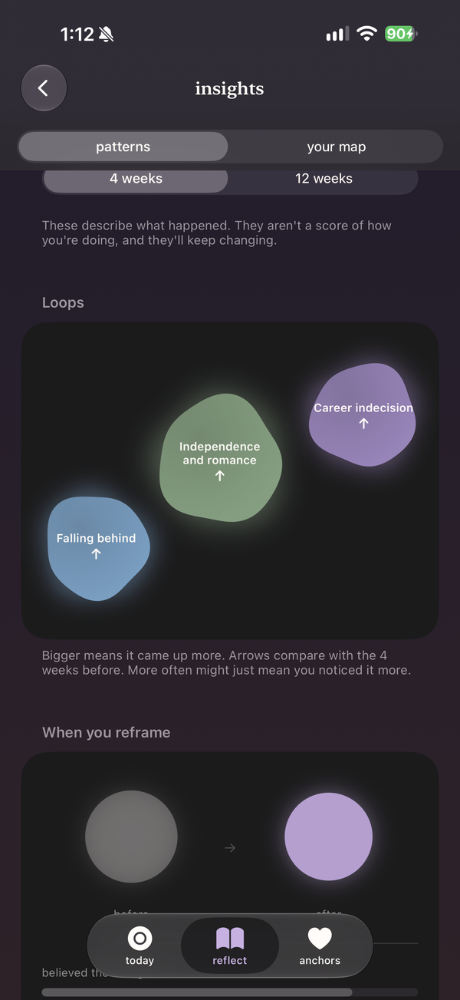

# Unconditional

A private iOS journal for working through self-doubt one day at a time. Write, speak, or draw, reframe the thought, and come back to what holds you. Built with SwiftUI, SwiftData, PencilKit, Swift Charts, and the Speech framework.

Everything stays on the phone. See [PRIVACY.md](PRIVACY.md).

## Screenshots
| Today | Check in | Reflect | Insights |
|---|---|---|---|
|  |  |  |  |

## Screens
- **Welcome tour**: on first launch, an animated orb and one idea per screen. One step asks which thoughts you tend to get stuck on: pick from general starters (not good enough, comparing myself, worrying about the future, people-pleasing, overthinking decisions, wasted effort, love and belonging) or name your own. Another asks what matters to you, so your values are there in Anchors and at the heart of your map from the start. Replay it from Settings.
- **The orb**: the heart of the app. It reflects what the app is doing, never what it assumes you feel: resting on Today, listening (growing gently with your voice) while you speak, breathing with you, settling into a calm, steady shape after a reframe or a thought reset, and glowing (its light swells warmer and one soft halo spreads out) when you keep something good. On "how does this sit?" it warms and opens as you slide toward light; keeping a light moment as a win sends a small golden orb off toward Anchors. Touch it and it stretches toward your finger. Hold it (a faint hint says so until the first time) and it divides into your values, one small orb each, all the same size; tap the middle and they flow back together (a "gooey" metaball effect: blur plus an alpha threshold in Canvas). Saved thoughts rain back down in the Sunday look-back, and the orb's colors shift very slightly with the time of day.
- **Three tabs**: today, reflect, and anchors. Settings opens from the gear on Today.
- **One check-in for every kind of moment**, one thing per screen so it never feels like a form: choose how (four tiles), get it out (only the page, the orb, the canvas, or one word), "how does this sit?" (just the orb and a heavy-to-light slider; the orb warms as you slide, and Skip is fine), then "part of a loop?" and save. There's no separate button for good things. A light moment (0.6 or more) is offered a place in Anchors as a win and glows warm gold in Reflect; a heavier one is offered a reframe. Hard and good starting points (a small win, someone was kind, a calm moment, I learned something, I'm proud that) sit side by side behind a faint lightbulb on the writing page.
- **Home**: the first launch of the day, the orb swells in alone, then the words and choices fade in (tap anywhere to skip; later launches that day simply fade in). A white screen with the orb, a greeting, and one main action, "Check in". Below it, one soft "i'm spiraling" button. Everything else is under "More".
- **Today**: choose Write, Speak, Draw, or Words, get the thought out, and save. Write is a full page of paper with larger serif words. Speak is just the orb: tap it to talk and your words appear under it. "Next" only shows once there's something to keep. Optional starting points (about work or school, a rejection, a hard study session, feeling behind, a relationship worry, not sure what's next) fill in a few gentle questions. Speak transcribes your voice on-device. Draw gives the canvas the whole page, with color, eraser, undo, and brushes and paper in one small floating capsule. Words is for when full sentences won't come: first just an orb to type one word into; then the word in its orb, to slide left for heavier or right for lighter (how far is how much); then related feeling words bubble out around what you've kept, from the side you slid toward and in its strength (about 65 words for each side and strength, from "foggy" or "stretched thin" a little heavier to "like a fraud" or "sick with worry" a lot heavier), a couple closest in meaning and the rest spread across the whole list from a different spot each time, each bubble its own shade and glow (Apple's on-device word embedding in NaturalLanguage). Tap one to slide it too. The kept words become the entry ("tired (heavier, a lot) · hopeful (lighter, a little)") and say how it sits, so Words skips that step. Save always sits just above the tab bar.
- **Reframe** (a step, not a tab): two quiet screens, one thing to write on each. "What's the thought?" with one heavy-to-light slider, then "What would you tell a friend?" with "and now?" on the same slider. Afterwards your before and after show once as two orbs. Older reframes keep any evidence or small step they had.
- **Reflect**: your entries as a branch instead of a list. Each month grows a gently swaying stem down the page with a leaf for every check-in, on alternating sides: heavier entries are deep green-blue leaves, lighter ones gold, so a month reads at a glance. Tap a leaf and it opens into that entry with a zoom, like opening a journal page. Insights is one quiet tap away at the top.
- **I'm spiraling**: three calm moments with almost nothing to read. First the orb breathes three slow breaths with you ("slow down with me", tap to skip). Then a few heavy words drift slowly around the screen, your own loops among them; tap the ones in your head, or add your own. Then the rain cycle, as a sunset in your theme's colors fades in (bands of sky, a low striped sun with faint rings, drifting wisps, two soft hills, and the sun slowly setting toward the water): drag each word down into the water to let it go (it dissolves and the water ripples), or up into a small cloud to save it for Sunday. That's worry postponement made visible: on Sunday a quiet line on Today opens the look-back, where the cloud rains the saved thoughts back down for a calm look. If you've kept things that made you laugh, the close offers "want something lighter?"
- **One step at a time** (under "more" on Today): name something big or daunting, and each time you take a step toward it, however small and however it went, you leave a footprint in warm sand while a soft wash of water comes and goes at the bottom. Prints alternate left and right along a winding trail and soften with age but never disappear. There's no target, no percentage, and no finish line, so it can't become one more thing to fall short of. A path can rest for a while without being given up on. On "a hard day", slide how hard it was (a few words are optional) and the tide rises up the sand that far, then goes back out. Prints under the water darken like wet sand, rock gently, shimmer, and let go a few bubbles, then dry off where they were. No print is ever washed away and nothing is drawn as a step backward; a faint wave line marks the day in the trail. Afterwards one small card asks "anything you learned?", and leaving it empty is fine. Hard days aren't counted as steps anywhere.
- **Anchors**: one page that works like water. The top is the surface; scrolling down goes deeper, the background deepens and a gooey stream down the side slows, so the deeper you go, the steadier it gets. Things that made you laugh (a joke, a meme or screenshot, something someone said) float near the surface as slightly tilted cards. Wins ("you kept showing up") sparkle near the surface for about two weeks, then settle into a "kept over time" stone that opens them all by month (nothing is ever deleted on its own; long-press a win to keep it at the surface), words to come back to (your reminders) drift in the middle as cards you swipe through, grounding photos rest on the riverbed as stickers (Apple's Vision framework lifts the person, pet, or thing out of the photo on device, with a white die-cut border and a soft light that travels around the edge; a photo with no clear subject becomes a rounded sticker), and your values rest beside them as small orbs, all the same size, since what you care about doesn't shrink in a hard week. How much you've lived one lately shows as a ring when you open it. Each card lands as a drop and opens. One "+" adds any kind of anchor and drops it in from the top.
- **Values first**: after a reframe, the app leads with something you care about rather than a past success. Worth isn't earned by wins, so the win is optional.
- **Calm your body** (under "more" on Today): a one-minute breathing exercise; 5-4-3-2-1 grounding, where you tap the orb for each thing you notice; and release tension (DBT paired muscle relaxation), where the orb pulls in tight and trembles while you squeeze each part of your body for 5 seconds, then goes soft for 10 as you let go. Also a support page with crisis lines.
- **Insights** (Reflect): opens on a sentence or two about the month in plain words ("Falling behind came up most this month, usually in the evenings. After reframing, the distress usually eased a little."), (and older career reflections, if you have any). **On your mind lately** answers one question: each loop is an orb sized by how often it came up in the last four weeks, with a faint dotted ring showing its size the four weeks before, and good moments get a warm gold orb. Tap one for a plain sentence; otherwise the sentence describes what changed most. Everything is descriptive, never a score. Before-and-after orbs appear once, right after a reframe, when they mean something. Parked thoughts no longer have a section: on Sundays a quiet line on Today offers a calm look at them, with one Sunday-morning notification while any are waiting.
  - **Your map**: a soft web with your values in the middle and loops around them. You make the connections by hand: press a loop and pull, and a soft, gooey thread stretches out (the same metaball trick as the orb); drop it on another loop or a value and it ties on with a small bounce and a tap of haptics, then asks how connected it feels on a slider. Tap a knot to change that, or pull the knot off its thread until it lets go to untie. Loops that show up on the same day appear as faint dotted threads, the app's guesses: trace one to tie it, tap its sparkle to see why, or pull the sparkle away. Opening a loop shows two things: its core belief and the words you keep using in it (found on device with Apple's NaturalLanguage framework). Connections are made only with threads. The map sits on a calm night sky (slow-twinkling stars that drift a little as it turns, a faint warm glow at the middle, threads and loops that glow softly) and leans back like a tabletop model of the planets: the far side is smaller and fainter, labels always stay upright, and sliding sideways on empty space turns it (a small hand on an arc shows this until the first turn; an icon in the corner switches to a flat view). Whenever you start pulling a thread or moving something, it eases flat so it's easy to aim, then leans back when you let go. Tap a loop or value to light up what it's connected to while the rest fades back; tap a lit loop again to open it. To keep it calm, at most six loops show (quieter ones are one tap away), the app shows no more than two dotted guesses at once, and with more than four values they rest as small stars whose names appear when you tap a loop or value they connect to, or while you drag or aim at them. Values find the free spot nearest their linked loops without covering loop names, and you can drag them anywhere. Your guess at a shared root belief glows at the middle as a sun (tap it to write or change it); the app never decides the root for you. The sun starts as a small red star and slowly grows, warming to orange, yellow, white, and at last a soft blue, with every check-in and every thread you tie. It grows fast at first and then more slowly, only ever grows, and never shows a number. The map opens from day one, since tying threads needs no check-ins; the app's guesses fill in as you write. Tapping a loop lights up its threads and shows a small card with its name, core belief, and an "open" button. The first visit plays a ghost hand pulling a thread, then a hand on an arc shows the map turns.
- **Hidden gestures, shown once**: holding the orb, long-pressing a win, pulling a thread, and turning the map each get a small wordless cue (a pressing hand, a ghost thread) until you've used them.
- **Take a breath, from anywhere**: a lock screen widget and a Control Center control open a thought reset in one tap. The visible words are neutral ("take a breath"), since anyone can glance at a lock screen.
- **Settings** (gear on Today): your loops (add, rename, reorder, remove), theme and orb (including whether the orb moves always, only during exercises, or never), a daily reminder, Face ID lock, and your data: export everything to one readable JSON file, or restore from one (it adds what's missing and never overwrites).

## Data model (SwiftData)
| Model | Holds | Relationships |
|---|---|---|
| `Loop` | name, pattern, core belief, sort order | has many `Entry`, `MapLink` |
| `Entry` | date, kind (write/speak/draw), text, drawing data, good moment, self-compassion answers | belongs to one `Loop`, has one optional `Reframe` |
| `Reframe` | trigger, core belief, evidence for/against, kinder read, small step, distress and belief before/after | belongs to one `Entry` |
| `Win` | date, text, meaning, effort-to-outcome (0 to 1), kept at the surface | none |
| `PersonalValue` | name, meaning, lived lately (0 to 10) | none |
| `ResetThought` | thought, perspective, sort order | belongs to one `Loop` |
| `SavedReminder` | text | none |
| `ParkedThought` | thought, reviewed date, urgency at review, note | none |
| `CareerReflection` | moment, topic, learned, interesting, enjoyment, discouragement, urge to quit, quit source (older data; now a check-in starting point) | none |
| `TinyStep` | text, outcome (tried / let go), snoozed until (older data; replaced by paths) | none |
| `StepPath` | title, resting | has many `Footstep` |
| `Footstep` | what you did, date | belongs to one `StepPath` |
| `GroundingPhoto` | image (stored outside the database), cut out or whole, caption | none |
| `MapLink` | strength (0 to 1), confirmed or dismissed | links two `Loop`s, or a `Loop` and a `PersonalValue` |

You choose your own loops in the welcome tour. New properties always have defaults, so SwiftData migrates older data on its own. All data stays on the device.

## How it's built
- **SwiftUI + SwiftData**, no third-party packages. One `ModelContainer` holds every model (`AppSchema` in `UnconditionalApp.swift`), and views read it with `@Query`.
- **The orb** (`Theme/Orb.swift`) is drawn in a `Canvas` inside a `TimelineView`. Each blob is a ring of points pushed in and out by layered sine waves, so it never repeats exactly. States (resting, listening, breathing, settling, glowing) ease into each other rather than switching. Touch bends the edge toward your finger with a Gaussian bump, then it springs back with a decaying wobble.
- **Gooey effects** (`Views/Visuals/OrbFamily.swift`): orbs that split, merge, or pinch off are blurred and then passed through an alpha threshold, the classic metaball trick, all in one `Canvas` layer.
- **Anchors** is one scroll view drawn as water: the background, stream, and riverbed read the scroll position with `onScrollGeometryChange` so depth changes the color and calms the motion.
- **Speech** uses `SFSpeechRecognizer` with on-device recognition where the phone supports it; the live voice level drives the listening orb.
- **Insights** uses Swift Charts and Apple's `NaturalLanguage` framework (lemmatized nouns, verbs, and adjectives) for the words you keep using.
- **Calm by design**: no red anywhere, lowercase headings, sliders instead of yes/no, and looking back shows rings and orbs rather than scores. Reduce Motion is respected throughout.
- **Export** (`Services/DataTransfer.swift`) maps every model to a plain `Codable` record, so the file format is independent of the database and can be versioned.

## Tests
Unit tests live in `UnconditionalTests/` and use Swift Testing. They cover export and restore (a full round trip into a fresh database including map links, restoring twice, matching loops by name, opening older files, rejecting bad files), the plain-language Insights summary, the loop rings, choosing loops, placing values on the map clear of loop labels, the 2.5D map view, footprints, hard days and their export, Words (which feeling words are offered and how they are written down), the merged check-in prompts, the tide rising and going back out, the slider labels, and the orb's shapes and easing. Each test gets its own in-memory database. Run them in Xcode with **Product → Test** (⌘U).

## Requirements
Xcode 27 or later, iOS 18 or later.
